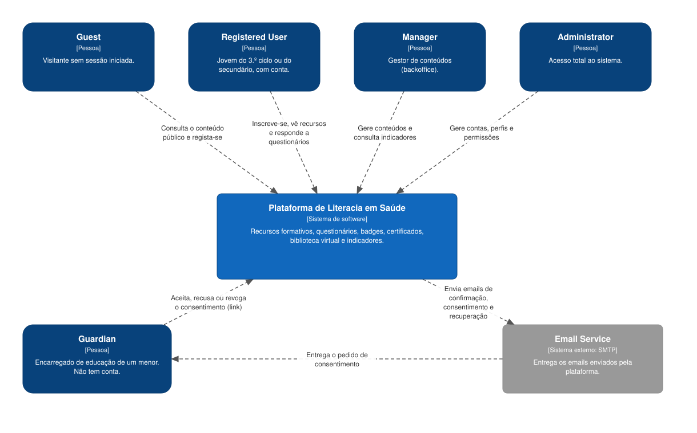
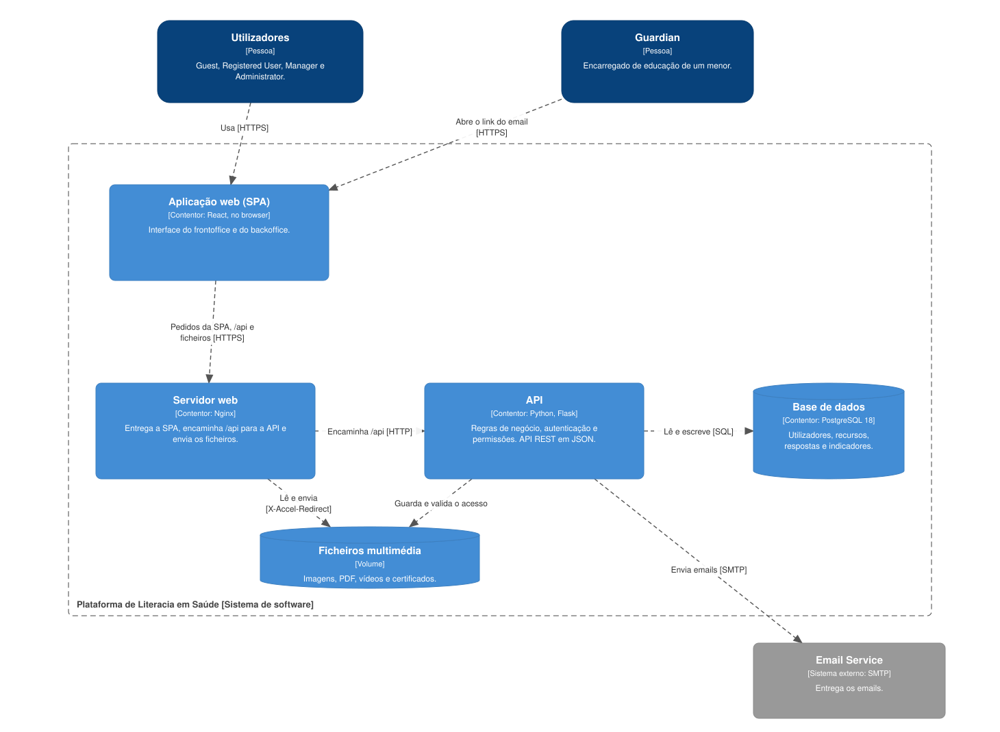

# Modelo C4

| | |
|---|---|
| User Story | US_A014 ([issue #14](https://github.com/escobar0304/ProjInter-2-1/issues/14)) |
| Versão | 1.0 (Sprint A) |
| Estado | Em revisão pela equipa |
| Fonte editável | [`c4.drawio`](c4.drawio) (páginas «C4 nível 1: contexto» e «C4 nível 2: contentores») |

O modelo C4 descreve a arquitetura em níveis de detalhe crescente. Este documento cobre os dois primeiros: o contexto do sistema e os seus contentores. Os nomes dos atores seguem o [glossário](../uml/glossario.md) e os [use cases](../uml/casos-de-uso.md).

## Nível 1: contexto

| Elemento | Tipo | Relação com o sistema |
|---|---|---|
| Guest | Pessoa | Consulta o conteúdo público, regista-se e inicia sessão (UC01 a UC04, UC07, UC08, UC13 a UC19). |
| Registered User | Pessoa | Gere os dados pessoais, inscreve-se nos recursos, vê as gravações e responde aos questionários (UC09 a UC12, UC20 a UC30). |
| Manager | Pessoa | Gere os conteúdos e os questionários e consulta os indicadores (UC31 a UC45). |
| Administrator | Pessoa | Gere as contas, os perfis e as permissões (UC46 a UC48). |
| Guardian | Pessoa (ator secundário) | Recebe o pedido de consentimento por email e decide pelo link, sem conta (UC05, UC06). |
| Email Service | Sistema externo (SMTP) | Entrega os emails de confirmação, de consentimento e de recuperação da palavra-passe (RNF26). |

## Nível 2: contentores

| Contentor | Tecnologia | Responsabilidade | ADR |
|---|---|---|---|
| Aplicação web (SPA) | React, a correr no browser | Interface do frontoffice e do backoffice. Chama a API e não guarda regras de negócio. | [ADR-0005](ADR-0005-spa-react-api-rest.md) |
| Servidor web | Nginx | Entrega os ficheiros da SPA, encaminha `/api` para a API e envia os ficheiros multimédia depois de a API autorizar. | [ADR-0004](ADR-0004-armazenamento-ficheiros.md), [ADR-0005](ADR-0005-spa-react-api-rest.md) |
| API | Python, Flask | Regras de negócio, autenticação, permissões e cálculo dos indicadores. API REST em JSON. | [ADR-0003](ADR-0003-autenticacao-sessao-cookie.md), [ADR-0005](ADR-0005-spa-react-api-rest.md) |
| Base de dados | PostgreSQL 18 | Dados do sistema ([modelo relacional](../base-de-dados/modelo-relacional.md)). | [ADR-0001](ADR-0001-sgbd-postgresql.md) |
| Ficheiros multimédia | Volume do servidor | Imagens, PDF, vídeos e certificados. | [ADR-0004](ADR-0004-armazenamento-ficheiros.md) |

Todos os contentores correm em Docker, com Docker Compose, a partir da Sprint B ([ADR-0002](ADR-0002-contentores-docker.md)). O browser só fala com o servidor web, por isso o frontend e a API partilham a mesma origem.

## Coerência com os requisitos

| Requisito | Onde aparece |
|---|---|
| RNF17: apresentação, lógica de negócio e dados separados | SPA, API e base de dados são contentores diferentes. |
| RNF18, RNF19, RNF20: React, Flask e PostgreSQL | Tecnologia de cada contentor. |
| RNF21: Docker | Todos os contentores ([ADR-0002](ADR-0002-contentores-docker.md)). |
| RNF24: permissões verificadas no backend | Só a API decide o acesso, incluindo aos ficheiros reservados. |
| RNF25: HTTPS em produção | O servidor web termina o HTTPS para todos os pedidos. |
| RNF26: serviço de email externo | Email Service, chamado pela API por SMTP. |
