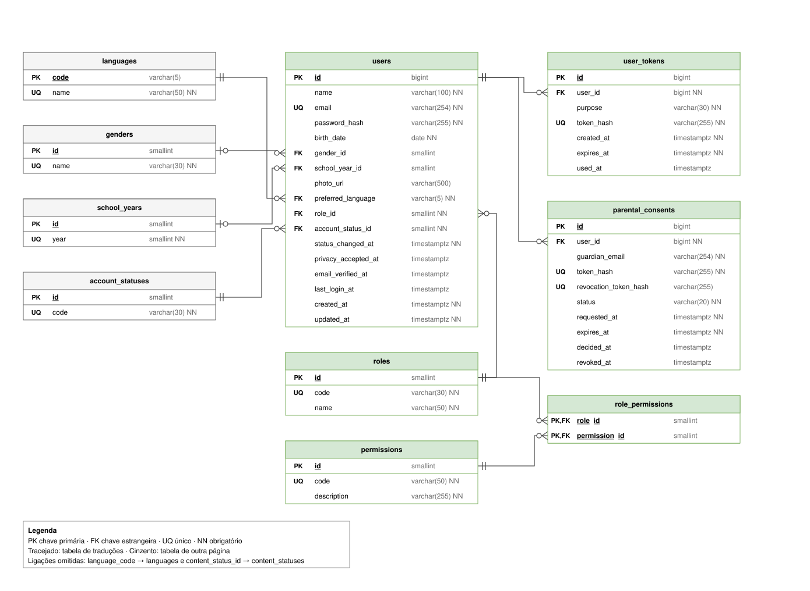
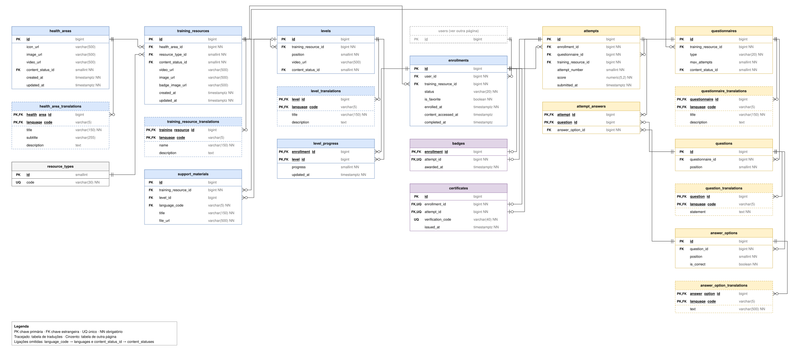
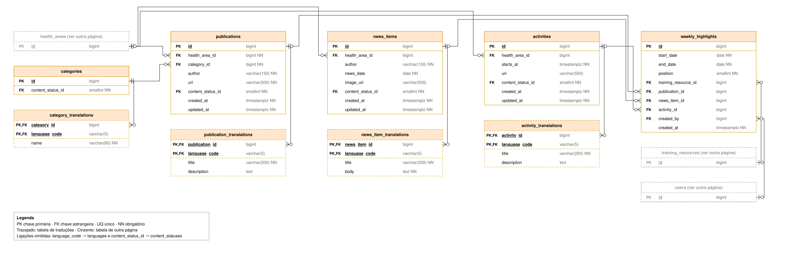

# Modelo relacional de dados (v1.1)

| | |
|---|---|
| User Story | US_A003 ([issue #3](https://github.com/escobar0304/ProjInter-2-1/issues/3)) |
| Versão | 1.1 (Sprint A), a partir da v1.0 fornecida |
| Estado | Em revisão pela equipa |
| Fonte editável | [`modelo-relacional.drawio`](modelo-relacional.drawio) (páginas «Conta e acesso», «Formação e questionários» e «Biblioteca virtual») |
| Script SQL | [`database/schema.sql`](../../database/schema.sql) (PostgreSQL 16 ou superior) |

## 1. Âmbito

Este documento acompanha o modelo relacional v1.1 da Plataforma de Literacia em Saúde para Jovens. Reformula o modelo v1.0 fornecido (especificação, §C.2) para suportar os requisitos do [levantamento de requisitos](../requisitos/furps.md) (US_A001) e os [use cases](../uml/casos-de-uso.md) (US_A002).

### Convenções

- Os nomes das tabelas e das colunas seguem o [glossário](../uml/glossario.md) (US_A004), em inglês, no plural e em `snake_case` (ex.: Training Resource → `training_resources`).
- As chaves primárias técnicas chamam-se `id` e são geradas pela base de dados (`GENERATED ALWAYS AS IDENTITY`). As chaves estrangeiras chamam-se `<tabela no singular>_id`.
- As datas com hora usam `timestamptz` e as datas sem hora usam `date`.
- Os textos traduzíveis ficam numa tabela `<entidade>_translations`, com chave primária composta (`<entidade>_id`, `language_code`).
- O `schema.sql` é a fonte de verdade. O diagrama é gerado a partir da mesma estrutura e o CI cria uma base de dados vazia a partir do script em cada Pull Request.

## 2. Diagramas

As ligações para `languages` e `content_statuses` não estão desenhadas, para o diagrama ficar legível. As tabelas a cinzento estão desenhadas noutra página.

### Conta e acesso



### Formação e questionários



### Biblioteca virtual



## 3. Tabelas

São 40 tabelas: 24 com os dados do domínio, 6 de referência e 10 de traduções.

| Área | Tabelas | Termos do glossário |
|---|---|---|
| Referência | `languages`, `genders`, `school_years`, `account_statuses`, `content_statuses`, `resource_types` | Language, School Year, Account Status, Content Status, Resource Type |
| Conta e acesso | `users`, `roles`, `permissions`, `role_permissions`, `user_tokens`, `parental_consents` | User, Role, Permission, Email Verification, Parental Consent |
| Formação | `health_areas`, `training_resources`, `levels`, `support_materials`, `enrollments`, `level_progress` | Health Area, Training Resource, Level, Support Material, Enrollment |
| Questionários | `questionnaires`, `questions`, `answer_options`, `attempts`, `attempt_answers` | Questionnaire, Question, Answer Option, Attempt, Answer |
| Gamificação | `badges`, `certificates` | Badge, Certificate |
| Biblioteca virtual | `categories`, `publications`, `news_items`, `activities`, `weekly_highlights` | Category, Publication, News Item, Activity, Weekly Highlight |
| Traduções | `health_area_translations`, `training_resource_translations`, `level_translations`, `questionnaire_translations`, `question_translations`, `answer_option_translations`, `category_translations`, `publication_translations`, `news_item_translations`, `activity_translations` | Translation |

O detalhe de cada coluna (tipo, obrigatoriedade, domínio e exemplo) está no [dicionário de dados](dicionario-dados.md) (US_A007).

## 4. Alterações face à v1.0

| v1.0 | v1.1 | Motivo |
|---|---|---|
| `resources` | `training_resources` | Termo do glossário (Training Resource). |
| `resourcelevels` | `levels` | Termo do glossário (Level). |
| `resourcelevels.pdf_url` | `support_materials` | Um Training Resource ou um Level pode ter vários materiais de apoio, em vários idiomas (RF16, RF31). |
| `resource_user` | `enrollments` | Separa a inscrição (Enrollment) do registo (Registration). Ganha o estado e a data de conclusão (RF15). |
| `resourcelevel_user` | `level_progress` | Passa a depender da Enrollment: só tem progresso quem está inscrito. |
| `quizzes`, `quiztypes` | `questionnaires`, com `type` (`diagnostic` ou `final`) | Só há dois tipos, fixos pela especificação (§D.1), por isso uma restrição `CHECK` substitui a tabela. Ganha `max_attempts` (pressupostos D01 e D04). |
| `answers` | `answer_options` | A tabela guarda as alternativas; a resposta do User fica em `attempt_answers`. |
| `quiz_user` | `attempts` | Cada submissão é uma Attempt com número, data e Score (RF19, RF21). Liga-se à Enrollment em vez do User. |
| `quiz_user.grade` | `attempts.score` | Score em percentagem, de 0 a 100 (glossário). |
| — | `attempt_answers` | Nova. Guarda a opção escolhida em cada Question, necessária para a proporção de respostas corretas por pergunta (RF40) e para a exportação (RF44). |
| `resources.badge_url` | `training_resources.badge_image_url` e `badges` | A imagem fica no recurso (um Badge por recurso, D09); a atribuição a cada User fica em `badges` (RF23, RF24). |
| — | `certificates` | Nova. Regista a emissão do certificado, com um código de verificação (RF23, RF25, D05). |
| `users.parental_consent` | `parental_consents` | Um booleano não chega: é preciso o email do Guardian, o token do pedido, o token de revogação, o estado e as datas do pedido, da decisão e da revogação (RF03, RF04, RF45, RNF22). |
| `users.remember_token` | `user_tokens` | Os links de verificação do email e de recuperação da palavra-passe passam a ter validade e uso único (RF02, RF06). Guarda-se só o hash do token. |
| `users.password` | `users.password_hash` | O nome deixa claro que nunca se guarda a palavra-passe em claro (RNF23). |
| `role_user` | `users.role_id` | Cada User tem um só Role (RF33). |
| — | `permissions`, `role_permissions` | Novas. O Administrator define as permissões de cada Role (RF34, RNF24). |
| `userstates` | `account_statuses` | Termo do glossário (Account Status). |
| `resourcestates`, `qastates` (duas vezes) | `content_statuses` | Um só estado de publicação para todos os conteúdos (RF30). A v1.0 tinha `qastates` e `resourcestates` duplicadas. |
| `qastate_id` em `questions` e `answers` | só em `questionnaires` | As Questions e as Answer Options são publicadas com o seu Questionnaire. |
| `contents`, `contenttypes` | `publications`, `categories` | Termos do glossário (Publication, Category). |
| `news` | `news_items` | Termo do glossário (News Item). |
| `schoolyears` | `school_years` | `snake_case` e valores de 7 a 12. |
| — | `weekly_highlights` | Nova. Os destaques da semana são escolhidos pelo Manager para um período (RF10, RF28, D10). |
| — | `languages` e as tabelas `*_translations` | Novas. Conteúdos em português e em inglês, e outros idiomas sem alterar o código (RF31, RNF13, D08). |
| — | `users.last_login_at`, `users.preferred_language` | Novas. Contar os Users ativos (RF36, D06) e escolher o idioma da interface (RNF05). |
| — | `users.status_changed_at`, `users.privacy_accepted_at` | Novas. Contar os prazos de eliminação de registos não concluídos ou recusados e registar a aceitação da política de privacidade (RNF22). Vêm do fluxograma do registo (US_A008). |
| Colunas de texto (`title`, `description`, ...) nas tabelas de conteúdos | Nas tabelas `*_translations` | Os textos traduzíveis saem da tabela principal. |
| — | `enrollments.content_accessed_at` | Nova. Num recurso sem Levels, regista quando o User viu o conteúdo, que é condição para responder ao Final (RF20). Nos recursos com Levels, essa informação vem de `level_progress`. |
| — | `attempts.training_resource_id` | Nova. Permite as chaves estrangeiras compostas que garantem que o Questionnaire de uma Attempt é do mesmo recurso da Enrollment. |

## 5. Decisões de modelação

- **Traduções numa tabela por entidade.** Cada tabela de traduções tem chaves estrangeiras reais para a entidade e para o idioma, o que não acontece com uma tabela genérica de traduções. Acrescentar um idioma é só uma linha em `languages` (RNF13).
- **Tabelas de referência em vez de `CHECK`** quando os valores aparecem na interface ou podem crescer (estados de conta e de conteúdo, géneros, anos, tipos de recurso). **`CHECK`** quando os valores são fixos pela especificação e só o código os usa (tipo de questionário, estado da inscrição, estado do consentimento, finalidade do token).
- **Attempts ligadas à Enrollment.** Garante que só responde a um questionário quem está inscrito no recurso (RF16, RF18).
- **`attempts.training_resource_id` repetido de propósito.** É a única exceção à 3.ª forma normal: o recurso já se obtém pela Enrollment e pelo Questionnaire. A coluna existe para as chaves estrangeiras compostas `(enrollment_id, training_resource_id)` e `(questionnaire_id, training_resource_id)`, que impedem uma Attempt com um Questionnaire de outro recurso. Como as duas chaves apontam para o mesmo valor, a repetição não pode ficar incoerente.
- **Badge e Certificate ligados à Enrollment e à Attempt.** A chave da Enrollment impede dois badges para o mesmo recurso; a Attempt guarda o Score que deu origem à atribuição.
- **Weekly Highlight aponta para um só conteúdo**, através de colunas opcionais e de um `CHECK` com `num_nonnulls(...) = 1`. Mantém as chaves estrangeiras, ao contrário de um par genérico tipo/id.
- **Tokens guardados como hash.** Uma fuga da base de dados não permite usar os links enviados por email.
- **Dados de referência no `schema.sql`.** Os idiomas, os estados, os Roles e as permissões iniciais são necessários para a aplicação arrancar. Os dados de teste ficam para a US_A016.

## 6. Regras de negócio

### Garantidas pela base de dados

| Regra | Como |
|---|---|
| Um email por conta | `UNIQUE (users.email)` |
| Uma inscrição por User e recurso | `UNIQUE (enrollments.user_id, training_resource_id)` |
| Um Diagnostic e um Final por recurso | `UNIQUE (questionnaires.training_resource_id, type)` |
| No máximo uma opção correta por pergunta | Índice único parcial `answer_options_one_correct` |
| A opção escolhida pertence à pergunta respondida | Chave estrangeira composta `(answer_option_id, question_id)` em `attempt_answers` |
| O Questionnaire de uma Attempt é do recurso em que o User está inscrito | Chaves estrangeiras compostas `(enrollment_id, training_resource_id)` e `(questionnaire_id, training_resource_id)` em `attempts` |
| Uma resposta por pergunta em cada Attempt | Chave primária `(attempt_id, question_id)` |
| Números de tentativa sem repetição | `UNIQUE (attempts.enrollment_id, questionnaire_id, attempt_number)` |
| Score entre 0 e 100 | `CHECK` em `attempts.score` |
| Um Badge e um Certificate por inscrição | Chave primária ou `UNIQUE` em `enrollment_id` |
| Um só pedido de consentimento aberto (pendente ou aceite) por User | Índice único parcial `parental_consents_one_open` |
| Um consentimento decidido tem data de decisão; um revogado tem data de revogação; um aceite tem token de revogação | `CHECK` em `parental_consents` |
| Uma inscrição concluída tem data de conclusão | `CHECK` em `enrollments` |
| Um destaque aponta para exatamente um conteúdo e o período é válido | `CHECK` em `weekly_highlights` |

### Garantidas pelo backend

| Regra | Requisitos |
|---|---|
| Um Minor só fica `active` depois de verificar o email e de o consentimento ser aceite | RF03, RF04 |
| Se o consentimento for revogado, a conta passa a `suspended` | RF45 |
| O token de revogação é criado quando o Guardian aceita, e é enviado no email de confirmação da decisão | RF45 |
| Os registos não concluídos e as contas com consentimento recusado são eliminados ao fim do prazo, contado a partir de `status_changed_at` | RNF22 |
| O conteúdo de um recurso só é acessível depois da 1.ª Attempt do Diagnostic | RF16, RF18 |
| O Final só pode ser respondido depois do Diagnostic e depois de o User ver o conteúdo (`level_progress` ou, num recurso sem Levels, `enrollments.content_accessed_at`) | RF20 |
| O número de Attempts não ultrapassa `max_attempts` | RF19, D01, D04 |
| Cada pergunta tem pelo menos 2 opções e exatamente uma correta antes de o questionário ser publicado | RF29 |
| As perguntas, as opções e a opção correta não podem ser alteradas depois da primeira Attempt do questionário, para os Scores e o Learning Gain continuarem comparáveis | RF29, RF40 |
| O Score é calculado no servidor e a Attempt é gravada numa só transação, com as respostas | RF21, RNF08 |
| O Badge e o Certificate são atribuídos na primeira Attempt do Final com 85% ou mais | RF23, D04 |
| O texto em português existe sempre; o inglês é opcional | RF31, D08 |
| Só os conteúdos `published` aparecem no frontoffice | RF30 |
| As permissões são verificadas em todos os pedidos | RNF24 |

## 7. Pressupostos

O modelo segue os pressupostos do [glossário](../uml/glossario.md) (secção 3) para as dúvidas D01 a D11. Os que afetam a estrutura são:

- D01 e D04: o número máximo de Attempts é configurável em cada Questionnaire (`max_attempts`, 2 por omissão).
- D06: um User ativo é um User com `last_login_at` nos últimos 30 dias.
- D08: o inglês aplica-se também aos conteúdos, por isso há tabelas de traduções.
- D09: há um só Badge por Training Resource, por isso não há uma tabela de tipos de badge.
- D11: o Guardian não tem conta; o email e a decisão ficam em `parental_consents`.

## 8. Como validar

- O CI (job «Schema PostgreSQL») cria a base de dados a partir de `database/schema.sql` em cada Pull Request.
- Localmente, com uma base de dados vazia:

  ```bash
  psql -d <base_de_dados> -v ON_ERROR_STOP=1 -f database/schema.sql
  ```
