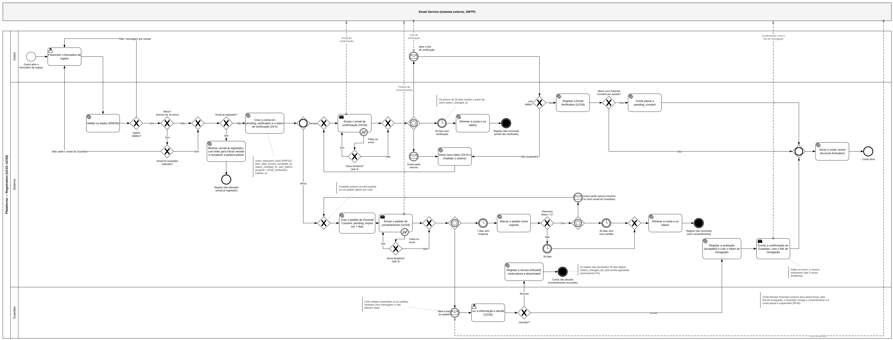

# Fluxograma do UC «Register User» (BPMN)

| | |
|---|---|
| User Story | US_A008 ([issue #8](https://github.com/escobar0304/ProjInter-2-1/issues/8)) |
| Versão | 1.0 (Sprint A) |
| Estado | Em revisão pela equipa |
| Fonte editável | [`registo-utilizador.drawio`](registo-utilizador.drawio) |

## 1. Âmbito

Este documento acompanha o fluxograma do processo de Registration: desde o momento em que o Guest abre o formulário de registo até a conta ficar Active ou o registo terminar sem sucesso. Inclui o pedido de Parental Consent quando o User é Minor.

O fluxograma detalha os use cases UC01 a UC05 do [diagrama de use cases v1.1](../uml/casos-de-uso.md) e usa os termos do [glossário](../uml/glossario.md). Os nomes das tabelas, das colunas e dos estados são os do [modelo relacional v1.1](../base-de-dados/modelo-relacional.md) (US_A003) e do [dicionário de dados](../base-de-dados/dicionario-dados.md) (US_A007).

## 2. Diagrama

## 3. Notação

O diagrama segue o BPMN 2.0, desenhado no draw.io.

| Elemento | Uso no diagrama |
|---|---|
| Pool | «Plataforma — Registration», com as raias Guest, Sistema e Guardian. O Email Service é uma pool separada, sem detalhe interno (caixa negra), porque é um sistema externo. |
| Raia (lane) | Um interveniente da plataforma. Os fluxos de sequência passam de uma raia para outra. |
| Tarefa de utilizador | Ação feita por uma pessoa (Guest ou Guardian). |
| Tarefa de serviço | Ação automática do Sistema. |
| Tarefa de envio | Pedido de envio de um email ao Email Service. |
| Fluxo de mensagem (tracejado) | Comunicação entre a plataforma e o Email Service: pedidos de envio e emails entregues ao Guest ou ao Guardian. |
| Gateway exclusivo (X) | Decisão com uma só saída. Todas as saídas têm rótulo, exceto nos gateways que só juntam caminhos. |
| Gateway inclusivo (O) | Divide o processo depois da criação da conta: o ramo da verificação do email segue sempre e o ramo do consentimento só para um Minor. O gateway de junção espera pelos ramos que foram ativados. |
| Gateway baseado em eventos | O Sistema fica à espera do primeiro de vários eventos (ex.: o link é aberto ou o prazo termina). |
| Evento de mensagem | Chegada de uma ação externa: o link aberto ou um pedido de reenvio. |
| Evento temporizado | Fim de um prazo (24 h, 7 dias ou 30 dias). |
| Evento de erro de fronteira | Falha no envio de um email. |
| Evento de fim | Fim normal (Conta ativa ou email já registado). |
| Evento de fim *terminate* | Fim sem sucesso. Termina o processo inteiro, incluindo o outro ramo que ainda estiver à espera. |
| Anotação | Detalhe dos dados gravados, dos prazos e do que fica fora do fluxo. |

## 4. Participantes e raias

| Participante | Tipo | O que faz no fluxo |
|---|---|---|
| Guest | Raia | Preenche o formulário de registo, abre o link de verificação e pode pedir o reenvio dos emails. |
| Sistema | Raia | Valida os dados, cria a conta e os tokens, regista a Email Verification e a decisão do Guardian, controla os prazos e faz a Account Activation. |
| Guardian | Raia | Abre o link do pedido de Parental Consent, lê a informação e aceita ou recusa. Não tem conta (D11). |
| Email Service | Pool externa | Envia o email de confirmação, o pedido de consentimento e a confirmação da decisão com o link de revogação (RNF26). |

## 5. Caminhos

### Caminho principal (adulto)

1. O Guest abre o formulário de registo e preenche o nome, o email, a palavra-passe, a data de nascimento, o género (opcional) e o ano de escolaridade, e aceita a política de privacidade (RF01, RNF22).
2. O Sistema valida os dados (RNF06), incluindo as validações do pressuposto P7.
3. O Sistema confirma que o email ainda não está registado.
4. O Sistema calcula a idade a partir de `birth_date`. O User não é Minor (D02).
5. O Sistema cria a conta em `pending_verification`, com a palavra-passe em hash (RNF23) e `privacy_accepted_at`, e cria o token de verificação, válido 24 horas (P1).
6. O Sistema pede ao Email Service o envio do email de confirmação (UC02, RF02).
7. O Guest abre o link de verificação. O Sistema confirma que o link é válido e regista a Email Verification (UC04): `email_verified_at` no User e `used_at` no token.
8. O Sistema ativa a conta (`active`) e o processo termina em «Conta ativa».

### Caminho do Minor

1. Se o User tiver menos de 18 anos à data do registo, o formulário pede o email do Guardian (RF03).
2. Depois de criar a conta, o processo segue dois ramos em paralelo: a verificação do email (como no caminho principal) e o pedido de Parental Consent.
3. No ramo do consentimento, o Sistema cria um registo em `parental_consents` com o estado `pending`, o `guardian_email`, o `token_hash`, o `requested_at` e o `expires_at` (7 dias). Depois, pede ao Email Service o envio do pedido de consentimento (UC03).
4. No ramo da verificação, quando o Guest verifica o email e o consentimento ainda não foi aceite, a conta passa a `pending_consent`.
5. O Guardian abre o link do pedido, lê a informação e decide (UC05). O Sistema regista a decisão com `decided_at` (RF04).
6. Se o Guardian aceitar, o Sistema cria o `revocation_token_hash` e envia-lhe a confirmação, com o link de revogação (RF45).
7. A conta só passa a `active` quando os dois ramos terminam com sucesso: o email verificado **e** o consentimento `accepted`. O consentimento é sempre pedido e registado antes da Account Activation (§C).

A ordem dos dois ramos não importa. Se o Guardian aceitar antes de o Guest verificar o email, a conta fica em `pending_verification` até à verificação e passa logo a `active`.

### Erros e caminhos sem sucesso

| # | Situação | O que acontece | Termina em |
|---|---|---|---|
| E1 | Dados inválidos | O Sistema mostra a mensagem que indica o campo e o que corrigir (RNF06) e o Guest volta ao formulário. | Volta ao formulário |
| E2 | Email já registado | O Sistema mostra a mensagem «email já registado», com os links para iniciar sessão e recuperar a palavra-passe (P2). | Fim «Registo não efetuado» |
| E3 | Minor sem email do Guardian | O Sistema pede o email do Guardian e o Guest volta ao formulário. | Volta ao formulário |
| E4 | Link de verificação expirado | O Sistema gera um token novo (24 h), invalida o anterior e reenvia o email de confirmação. O Guest também pode pedir o reenvio se não receber o email. | Volta à espera da verificação |
| E5 | Email nunca verificado | Ao fim de 30 dias, a conta e os dados são eliminados (P3). | Fim *terminate* «Registo não concluído (email não verificado)» |
| E6 | Consentimento recusado | O Sistema regista a recusa (`refused`) e a conta passa a `deactivated`. Os dados são eliminados 30 dias depois pela tarefa agendada (P4). | Fim *terminate* «Conta não ativada (consentimento recusado)» |
| E7 | Consentimento expirado sem resposta | Ao fim de 7 dias, o pedido passa a `expired`. O Guest pode reenviar o pedido, para o mesmo email ou para outro, até 2 vezes. Sem novo pedido, ou com os reenvios esgotados, a conta e os dados são eliminados ao fim de 30 dias (P5). | Fim *terminate* «Registo não concluído (sem consentimento)» |
| E8 | Falha no envio de um email | O Sistema tenta enviar o email mais 3 vezes. Se não conseguir, o processo continua à espera: o Guest pode pedir o reenvio, e os prazos de E5 e E7 aplicam-se na mesma (P6). | Volta à espera |
| E9 | Link antigo (expirado ou já usado) | O Sistema mostra uma mensagem e não altera nada. | Fora do processo (anotação) |

Os caminhos que voltam ao formulário ou à espera não ficam em aberto: o processo termina sempre num dos eventos de fim, porque os prazos de 30 dias (P3 e P5) acabam por ser atingidos. Se o Guest fechar o formulário antes de o submeter, não se grava nada.

## 6. Rastreabilidade

### Use cases

| UC | Nome | Onde aparece no fluxograma |
|---|---|---|
| UC01 | Register User | Todo o fluxo da pool «Plataforma — Registration». |
| UC02 | Send Confirmation Email («include» de UC01) | Tarefa «Enviar o email de confirmação», feita sempre. |
| UC03 | Request Parental Consent («extend» de UC01, condição Minor) | Ramo do consentimento, que só segue quando o User é Minor. |
| UC04 | Verify Email | Evento «Abre o link de verificação» e tarefa «Registar a Email Verification». |
| UC05 | Decide Parental Consent | Raia Guardian: «Ler a informação e decidir» e o gateway «Decisão?». |
| UC06 | Revoke Parental Consent | Fora do fluxo, numa anotação. O link de revogação é enviado quando o Guardian aceita. |

### Requisitos

| Requisito | Onde aparece no fluxograma |
|---|---|
| RF01 | Formulário de registo, preenchido pelo Guest. |
| RF02 | Envio do email de confirmação e Email Verification só depois de o link ser aberto. |
| RF03 | Gateway «Minor?», pedido do email do Guardian e envio do pedido de consentimento. |
| RF04 | Registo da decisão com `decided_at`; a conta do Minor só é ativada com o consentimento `accepted`. |
| RF45 | Token de revogação criado quando o Guardian aceita (UC06 fica fora do fluxo). |
| RNF06 | Validação dos dados, com a mensagem que indica o campo. |
| RNF22 | Aceitação da política de privacidade, consentimento do Guardian e eliminação dos registos não concluídos ou recusados. |
| RNF23 | Palavra-passe guardada só em hash (`password_hash`). |
| RNF26 | Todos os emails são enviados pelo Email Service. |

## 7. Estados e dados usados

### Account Status (`account_statuses`)

| Estado | Quando |
|---|---|
| `pending_verification` | A conta é criada. Fica assim até o Guest verificar o email. |
| `pending_consent` | Só para um Minor: o email está verificado, mas o consentimento ainda não foi aceite. |
| `active` | Email verificado e, se for Minor, consentimento `accepted`. Só uma conta `active` pode iniciar sessão. |
| `deactivated` | O Guardian recusou o consentimento. Os dados são eliminados 30 dias depois. |
| `suspended` | Não é usado neste fluxo. A conta fica `suspended` se o Guardian revogar o consentimento (UC06, RF45). |

Cada mudança de estado atualiza `users.status_changed_at`. Os prazos de eliminação de 30 dias contam a partir desta data.

### Estado do Parental Consent (`parental_consents.status`)

| Estado | Quando |
|---|---|
| `pending` | O pedido é criado e enviado ao Guardian. |
| `accepted` | O Guardian aceita. Grava-se `decided_at` e cria-se o `revocation_token_hash`. |
| `refused` | O Guardian recusa. Grava-se `decided_at`. |
| `expired` | Passam 7 dias sem resposta. Num reenvio, o pedido anterior passa a `expired` antes de se criar o novo, porque só pode haver um pedido aberto (`pending` ou `accepted`) por User. |
| `revoked` | Não é usado neste fluxo (UC06). |

### Outros dados

| Dado | Uso |
|---|---|
| `users.birth_date` | Calcular se o User é Minor à data do registo (D02). |
| `users.password_hash` | Palavra-passe em hash (RNF23). |
| `users.privacy_accepted_at` | Data da aceitação da política de privacidade (RNF22). |
| `users.email_verified_at` | Data da Email Verification. |
| `user_tokens` (`purpose = 'email_verification'`) | Link de verificação: guarda-se o hash do token, com `expires_at` (24 h) e `used_at` (uso único). |
| `parental_consents` | Pedido de consentimento: `guardian_email`, `token_hash`, `requested_at`, `expires_at` (7 dias), `decided_at` e `revocation_token_hash`. |

Os reenvios contam-se pelas linhas de `user_tokens` e de `parental_consents` de cada User: não há uma coluna própria. O tipo, a obrigatoriedade e as restrições de cada coluna estão no [dicionário de dados](../base-de-dados/dicionario-dados.md).

## 8. Pressupostos

Pressupostos das dúvidas do [levantamento de requisitos](../requisitos/furps.md), já registados no [glossário](../uml/glossario.md):

| Dúvida | Pressuposto |
|---|---|
| D02 | Minor é um User com menos de 18 anos à data do registo. |
| D11 | O Guardian não tem conta e responde pelo link do email. |

Pressupostos da equipa sobre o que a especificação não define:

| ID | Pressuposto |
|---|---|
| P1 | Prazos: o link de verificação vale 24 horas; o pedido de consentimento vale 7 dias; os registos não concluídos são eliminados ao fim de 30 dias. |
| P2 | Se o email já estiver registado, o Sistema diz-o de forma explícita e mostra os links para iniciar sessão e recuperar a palavra-passe. |
| P3 | Se o email nunca for verificado, a conta e os dados são eliminados ao fim de 30 dias (RNF22, minimização dos dados). |
| P4 | Se o Guardian recusar, a conta passa a `deactivated` e não pode iniciar sessão. O registo da recusa fica guardado e os dados pessoais são eliminados ao fim de 30 dias. |
| P5 | Se o pedido de consentimento expirar, o Guest pode reenviá-lo, para o mesmo email ou para outro, até 2 vezes. Sem novo pedido, ou com os reenvios esgotados, a conta e os dados são eliminados ao fim de 30 dias. |
| P6 | Se o envio de um email falhar, a conta mantém-se. O Sistema tenta enviar mais 3 vezes, e o Guest pode pedir o reenvio. Se o email nunca for verificado, aplica-se P3. |
| P7 | Validações extra: o email do Guardian tem de ser diferente do email do Minor; a data de nascimento não pode ser no futuro; a aceitação da política de privacidade é obrigatória. |
| P8 | Não há idade mínima: o Parental Consent cobre todos os Minors, e o público-alvo vai do 7.º ao 12.º ano. |
