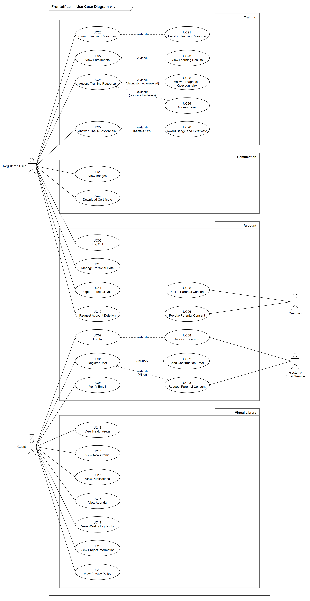
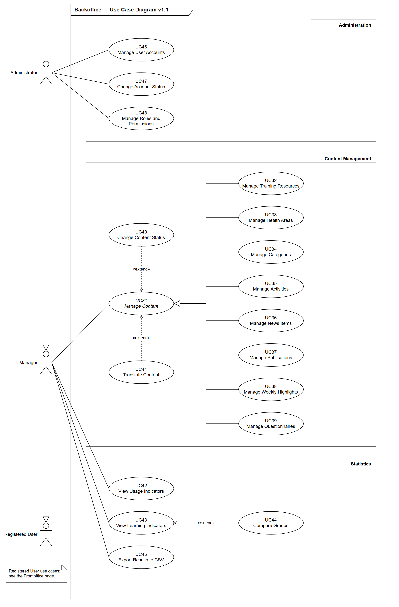

# Diagrama de use cases (v1.1)

| | |
|---|---|
| User Story | US_A002 ([issue #2](https://github.com/escobar0304/ProjInter-2-1/issues/2)) |
| Versão | 1.1 (Sprint A), a partir da v1.0 fornecida |
| Estado | Em revisão pela equipa |
| Fonte editável | [`casos-de-uso.drawio`](casos-de-uso.drawio) (páginas «Frontoffice» e «Backoffice») |

## 1. Âmbito

Este documento acompanha o diagrama de use cases v1.1 da Plataforma de Literacia em Saúde para Jovens. Reformula o diagrama v1.0 fornecido (especificação, §C.2) para cobrir todos os requisitos funcionais do [levantamento de requisitos](../requisitos/furps.md) (RF01 a RF46).

### Convenções

- Os nomes dos atores e dos use cases seguem a linguagem ubíqua do [glossário](glossario.md) (US_A004), em inglês.
- Cada use case tem um ID fixo (`UCnn`): UC01 a UC30 no frontoffice e UC31 a UC48 no backoffice.
- Os use cases estão agrupados em pacotes que correspondem às áreas do levantamento de requisitos: Account (AUT), Virtual Library (PUB), Training (REC e QST), Gamification (GAM), Content Management (GES), Statistics (EST) e Administration (ADM).
- Notação UML: atores fora do limite do sistema (principais à esquerda, secundários à direita); associações sem seta; `«include»` como seta tracejada do caso base para o incluído; `«extend»` como seta tracejada da extensão para o caso base, com a condição entre chavetas; generalização como linha contínua com triângulo vazio a apontar para o pai. Um nome em itálico indica um use case abstrato.

## 2. Diagramas

### Frontoffice

### Backoffice

## 3. Atores

| Ator | Tipo | Herda de | Fonte |
|---|---|---|---|
| Guest | Principal | — | §C.1 |
| Registered User | Principal | Guest | §C.1 |
| Manager | Principal | Registered User | §C.1 |
| Administrator | Principal | Manager | §C.1 |
| Guardian | Secundário | — | §C; RF04, RF45 |
| Email Service | Secundário (sistema externo) | — | RNF26 |

## 4. Use cases e rastreabilidade

### Frontoffice

| UC | Nome | Ator(es) | Requisitos |
|---|---|---|---|
| UC01 | Register User | Guest | RF01 |
| UC02 | Send Confirmation Email | Guest (por UC01), Email Service | RF02, RNF26 |
| UC03 | Request Parental Consent | Guest (por UC01), Email Service | RF03 |
| UC04 | Verify Email | Guest | RF02 |
| UC05 | Decide Parental Consent | Guardian | RF04 |
| UC06 | Revoke Parental Consent | Guardian | RF45 |
| UC07 | Log In | Guest | RF05 |
| UC08 | Recover Password | Guest (por UC07), Email Service | RF06 |
| UC09 | Log Out | Registered User | RF05 |
| UC10 | Manage Personal Data | Registered User | RF07 |
| UC11 | Export Personal Data | Registered User | RF46 |
| UC12 | Request Account Deletion | Registered User | RF46 |
| UC13 | View Health Areas | Guest | RF08 |
| UC14 | View News Items | Guest | RF09 |
| UC15 | View Publications | Guest | RF09 |
| UC16 | View Agenda | Guest | RF09 |
| UC17 | View Weekly Highlights | Guest | RF10 |
| UC18 | View Project Information | Guest | RF11 |
| UC19 | View Privacy Policy | Guest | RF11 |
| UC20 | Search Training Resources | Registered User | RF12, RF13 |
| UC21 | Enroll in Training Resource | Registered User (por UC20) | RF14 |
| UC22 | View Enrollments | Registered User | RF15 |
| UC23 | View Learning Results | Registered User (por UC22) | RF22 |
| UC24 | Access Training Resource | Registered User | RF12, RF16 |
| UC25 | Answer Diagnostic Questionnaire | Registered User (por UC24) | RF18, RF19, RF21 |
| UC26 | Access Level | Registered User (por UC24) | RF17 |
| UC27 | Answer Final Questionnaire | Registered User | RF20, RF21 |
| UC28 | Award Badge and Certificate | Registered User (por UC27) | RF23 |
| UC29 | View Badges | Registered User | RF24 |
| UC30 | Download Certificate | Registered User | RF24, RF25 |

### Backoffice

| UC | Nome | Ator(es) | Requisitos |
|---|---|---|---|
| UC31 | *Manage Content* (abstrato) | Manager | RF26–RF31 (através de UC32–UC41) |
| UC32 | Manage Training Resources | Manager (herdado de UC31) | RF26 |
| UC33 | Manage Health Areas | Manager (herdado de UC31) | RF27 |
| UC34 | Manage Categories | Manager (herdado de UC31) | RF27 |
| UC35 | Manage Activities | Manager (herdado de UC31) | RF28 |
| UC36 | Manage News Items | Manager (herdado de UC31) | RF28 |
| UC37 | Manage Publications | Manager (herdado de UC31) | RF28 |
| UC38 | Manage Weekly Highlights | Manager (herdado de UC31) | RF10, RF28 |
| UC39 | Manage Questionnaires | Manager (herdado de UC31) | RF29 |
| UC40 | Change Content Status | Manager (por UC31) | RF30 |
| UC41 | Translate Content | Manager (por UC31) | RF31 |
| UC42 | View Usage Indicators | Manager | RF36 |
| UC43 | View Learning Indicators | Manager | RF37, RF38, RF39, RF40, RF43 |
| UC44 | Compare Groups | Manager (por UC43) | RF41, RF42 |
| UC45 | Export Results to CSV | Manager | RF44, RNF27 |
| UC46 | Manage User Accounts | Administrator | RF32, RF33 |
| UC47 | Change Account Status | Administrator | RF35 |
| UC48 | Manage Roles and Permissions | Administrator | RF33, RF34 |

Pela generalização dos atores, o Administrator também executa os use cases do Manager, e o Manager os do Registered User.

### Relações entre use cases

| Relação | De | Para | Condição |
|---|---|---|---|
| «include» | UC01 Register User | UC02 Send Confirmation Email | — |
| «extend» | UC03 Request Parental Consent | UC01 Register User | Minor |
| «extend» | UC08 Recover Password | UC07 Log In | — |
| «extend» | UC21 Enroll in Training Resource | UC20 Search Training Resources | — |
| «extend» | UC23 View Learning Results | UC22 View Enrollments | — |
| «extend» | UC25 Answer Diagnostic Questionnaire | UC24 Access Training Resource | diagnostic not answered |
| «extend» | UC26 Access Level | UC24 Access Training Resource | resource has levels |
| «extend» | UC28 Award Badge and Certificate | UC27 Answer Final Questionnaire | Score ≥ 85% |
| «extend» | UC40 Change Content Status | UC31 Manage Content | — |
| «extend» | UC41 Translate Content | UC31 Manage Content | — |
| «extend» | UC44 Compare Groups | UC43 View Learning Indicators | — |
| Generalização | UC32 a UC39 | UC31 Manage Content | — |

### Cobertura dos requisitos funcionais

| Requisitos | Use cases |
|---|---|
| RF01–RF07 (AUT) | RF01: UC01 · RF02: UC02, UC04 · RF03: UC03 · RF04: UC05 · RF05: UC07, UC09 · RF06: UC08 · RF07: UC10 |
| RF08–RF12 (PUB) | RF08: UC13 · RF09: UC14, UC15, UC16 · RF10: UC17, UC38 · RF11: UC18, UC19 · RF12: UC20, UC24 |
| RF13–RF17 (REC) | RF13: UC20 · RF14: UC21 · RF15: UC22 · RF16: UC24 · RF17: UC26 |
| RF18–RF22 (QST) | RF18: UC25 · RF19: UC25 · RF20: UC27 · RF21: UC25, UC27 · RF22: UC23 |
| RF23–RF25 (GAM) | RF23: UC28 · RF24: UC29, UC30 · RF25: UC30 |
| RF26–RF31 (GES) | RF26: UC32 · RF27: UC33, UC34 · RF28: UC35–UC38 · RF29: UC39 · RF30: UC40 · RF31: UC41 |
| RF32–RF35 (ADM) | RF32: UC46 · RF33: UC46, UC48 · RF34: UC48 · RF35: UC47 |
| RF36–RF44 (EST) | RF36: UC42 · RF37–RF40: UC43 · RF41, RF42: UC44 · RF43: UC43 · RF44: UC45 |
| RF45, RF46 (equipa) | RF45: UC06 · RF46: UC11, UC12 |

O RF12 (conteúdo reservado só com sessão iniciada) é uma regra de acesso: fica coberto porque os use cases de conteúdo reservado estão associados ao Registered User e não ao Guest.

## 5. Alterações face à v1.0

| # | Alteração | Motivo |
|---|---|---|
| 1 | Nomes em inglês, iguais aos do glossário, e IDs de UC01 a UC48. | Linguagem ubíqua (US_A004) e rastreabilidade com os requisitos. |
| 2 | O ator User passa a Registered User e Admin passa a Administrator. | Glossário: User é o conceito que abrange todos os perfis; Administrator é o nome da §C.1. |
| 3 | Nova generalização Manager → Registered User, que completa a cadeia Administrator → Manager → Registered User → Guest. | Faltava na v1.0. A §C.1 diz que o Manager tem as funcionalidades do utilizador registado, e a §C.2 refere a herança entre os quatro atores. |
| 4 | Novos atores secundários: Guardian e Email Service. | O encarregado de educação decide e revoga o consentimento (§C; RF04, RF45). Os emails são enviados por um serviço externo (RNF26). |
| 5 | Associações sem seta e etiquetas `«include»` e `«extend»` com guillemets, em vez de "include" e "extends". | Notação UML. |
| 6 | Register User deixa de ser uma extensão de Log In. | Registar e iniciar sessão são objetivos independentes do Guest (§C.1: "Registar-se na plataforma"). |
| 7 | «Send Parental Consent Email» e «Send Parental Informed Consent Email» passam a ser só UC03 Request Parental Consent, `«extend»` de UC01 com a condição {Minor}. | Na v1.0, um use case incluía outro quase igual. O consentimento só se pede para menores (RF03), por isso é uma extensão condicional. |
| 8 | Answer Diagnostic Questionnaire passa a ser `«extend»` de Access Training Resource, com a condição {diagnostic not answered}. Answer Final Questionnaire passa a estar associado diretamente ao Registered User. | Na v1.0, Access Workshop / Webinars "estendia" os questionários (sentido trocado), e o questionário final não tinha ator. O diagnóstico só se responde antes do primeiro acesso ao conteúdo (§D.1, RF18). |
| 9 | «Get final grade» passa a UC23 View Learning Results, e «Get Certificate» passa a UC30 Download Certificate. | RF22 (classificação e comparação entre diagnóstico e final) e RF25 (certificado em PDF). |
| 10 | Novos use cases: UC04, UC05, UC06, UC09, UC11, UC12, UC17 e UC28. | RF02, RF04, RF45, RF05, RF46, RF10 e RF23 não estavam cobertos. |
| 11 | Os pacotes passam a corresponder às áreas do levantamento de requisitos. A Virtual Library fica só com o conteúdo público; os recursos formativos passam para o pacote Training. | Glossário (Virtual Library) e §C, que descreve a biblioteca como publicações, notícias, agenda e destaques. |
| 12 | «Manage Webinars» passa a UC32 Manage Training Resources, e «Manage Forms» passa a UC39 Manage Questionnaires. | Os recursos formativos incluem os workshops (RF26); "questionário" é o termo da especificação (RF29). |
| 13 | Sai «Manage Quizzes Types». | Os tipos de questionário são fixos (Diagnostic e Final) e não são geridos. |
| 14 | «Manage Web Info» passa a UC31 *Manage Content*, abstrato, com oito filhos (UC32 a UC39) e duas extensões herdadas (UC40 e UC41). | Cobre RF26 a RF31 sem repetir associações e setas; segue o padrão de generalização que a v1.0 já usava. |
| 15 | No backoffice, saem «Manage Personal Information» e a associação do Admin ao pacote «Personal Information». | Passa a ser herdado do Registered User. Uma associação liga um ator a um use case, não a um pacote. |
| 16 | «Manage Users» é dividido em UC46 a UC48, e «Get Statistics Data» em UC42 a UC45. | RF32 a RF35 (contas, perfis, permissões e estados) e RF36 a RF44 (indicadores, comparação de grupos e exportação CSV). |

## 6. Pressupostos

Enquanto as dúvidas do levantamento de requisitos não tiverem resposta, o diagrama usa as opções seguintes.

| Dúvida | Pressuposto | Use cases afetados |
|---|---|---|
| D01 | A 2.ª oportunidade do diagnóstico faz parte de UC25; o número máximo de tentativas é configurado no questionário. | UC25, UC39 |
| D02 | A idade-limite para pedir o consentimento é 18 anos. | UC03 |
| D03 | Os professores e os profissionais de saúde não têm um ator próprio: são Manager, se gerem conteúdos, ou Registered User. | Atores |
| D04 | O questionário final pode ser repetido (UC27); o badge e o certificado são atribuídos na primeira tentativa com 85% ou mais. | UC27, UC28 |
| D08 | A tradução aplica-se também aos conteúdos (recursos, questionários e biblioteca). | UC41 |
| D09 | Há um badge por recurso formativo. | UC28, UC29 |
| D10 | Os destaques da semana são escolhidos pelo Manager. | UC17, UC38 |
| D11 | O encarregado de educação responde pelo link do email e não tem conta. | UC05, UC06 |
