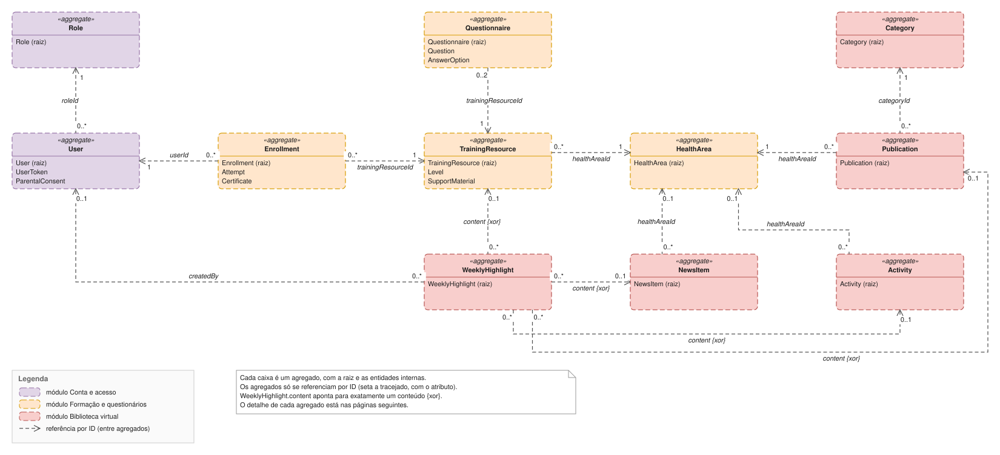
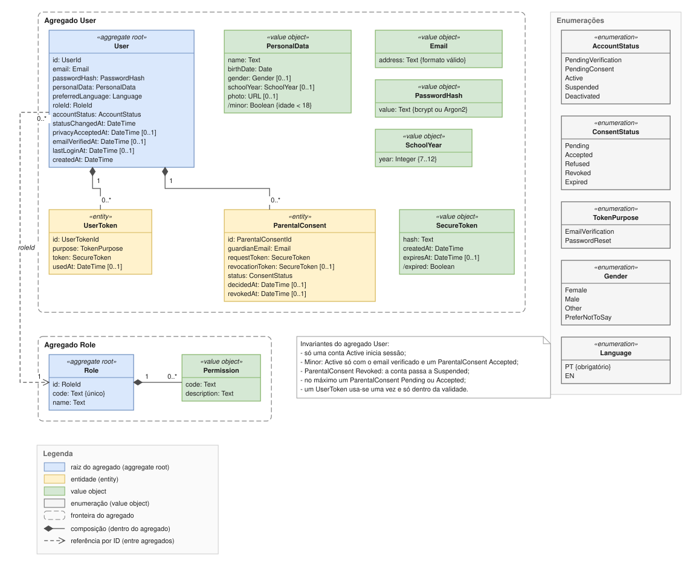
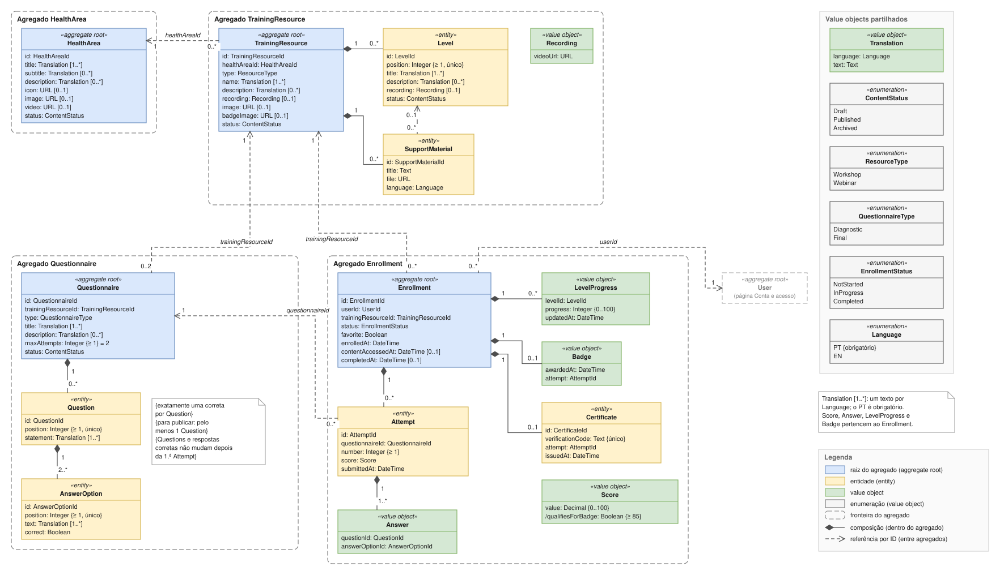
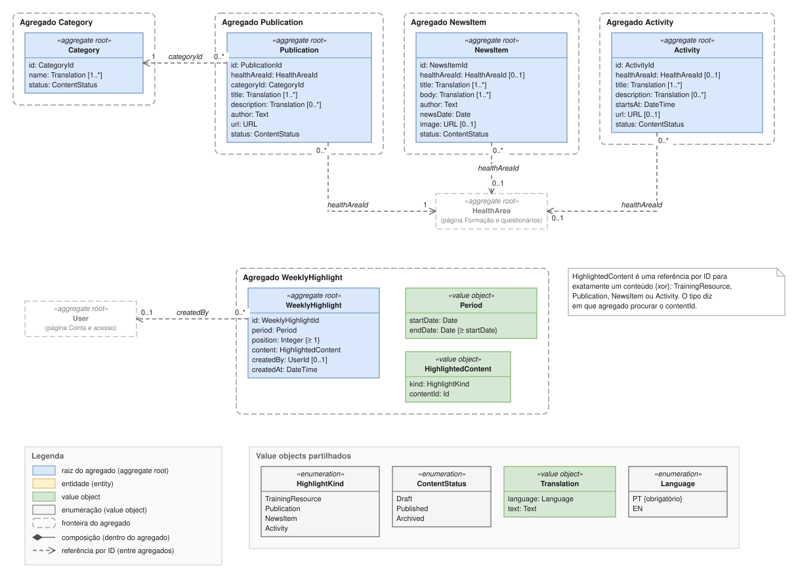

# Modelo de domínio (DDD)

| | |
|---|---|
| User Story | US_A004 ([issue #4](https://github.com/escobar0304/ProjInter-2-1/issues/4)), 2.ª parte |
| Versão | 1.0 (Sprint A) |
| Estado | Em revisão pela equipa |
| Fonte editável | [`modelo-dominio.drawio`](modelo-dominio.drawio) (páginas «Visão geral», «Conta e acesso», «Formação e questionários» e «Biblioteca virtual») |

## 1. Âmbito

Este documento descreve o modelo de domínio da Plataforma de Literacia em Saúde para Jovens, segundo o Domain-Driven Design (DDD): os agregados, as entidades, os value objects, os atributos de cada um e as regras de negócio que cada agregado protege. Ao contrário do diagrama de use cases e do modelo relacional, o modelo de domínio não foi fornecido.

O modelo usa a linguagem ubíqua do [glossário](glossario.md) (US_A004, 1.ª parte). É validado com os [use cases](casos-de-uso.md) (US_A002) e comparado com o [modelo relacional](../base-de-dados/modelo-relacional.md) (US_A003).

### Bounded context

A plataforma é um só bounded context: uma equipa, um glossário, uma base de dados e uma API ([ADR-0005](../arquitetura/ADR-0005-spa-react-api-rest.md)). Os agregados estão organizados em três módulos, um por página do diagrama: Conta e acesso, Formação e questionários, e Biblioteca virtual.

### Convenções

- **Diagrama de classes UML conceptual**, sem métodos e sem tipos de base de dados (esses ficam no `schema.sql` e no [dicionário de dados](../base-de-dados/dicionario-dados.md)).
- **Estereótipos e cores:** «aggregate root» (azul), «entity» (amarelo), «value object» (verde) e «enumeration» (cinzento). As enumerações também são value objects.
- **Fronteira do agregado:** retângulo a tracejado com o nome do agregado.
- **Composição** (losango cheio): liga a raiz às entidades e às coleções de value objects que fazem parte do agregado, com a multiplicidade nos dois extremos.
- **Referência entre agregados:** só por ID, num atributo `<agregado>Id` (ex.: `roleId: RoleId`), desenhada como seta a tracejado com a multiplicidade. Um agregado nunca contém outro.
- **Value object de um só valor:** aparece como tipo do atributo (ex.: `email: Email`) e está desenhado dentro da fronteira do agregado a que pertence.
- **Tipos conceptuais:** `Text`, `Integer`, `Decimal`, `Boolean`, `Date`, `DateTime` e `URL`. Cada agregado tem um tipo de identificador próprio (`UserId`, `TrainingResourceId`, ...).
- **Notação dos atributos:** `[0..1]` é opcional, `[1..*]` é uma lista com pelo menos um elemento, `/` marca um atributo derivado e `{...}` uma restrição.
- **Caixas a cinzento e a tracejado:** agregados desenhados noutra página, que só aparecem como destino de uma referência.

## 2. Diagramas

### Visão geral

Os onze agregados, as entidades de cada um e as referências por ID.

### Conta e acesso

### Formação e questionários

### Biblioteca virtual

## 3. Agregados

| Agregado | Raiz | Entidades | Value objects |
|---|---|---|---|
| User | User | UserToken, ParentalConsent | Email, PasswordHash, PersonalData, SchoolYear, SecureToken, AccountStatus, ConsentStatus, TokenPurpose, Gender, Language |
| Role | Role | — | Permission |
| HealthArea | HealthArea | — | Translation, ContentStatus |
| TrainingResource | TrainingResource | Level, SupportMaterial | Recording, ResourceType, Translation, ContentStatus, Language |
| Questionnaire | Questionnaire | Question, AnswerOption | QuestionnaireType, Translation, ContentStatus |
| Enrollment | Enrollment | Attempt, Certificate | EnrollmentStatus, LevelProgress, Badge, Score, Answer |
| Category | Category | — | Translation, ContentStatus |
| Publication | Publication | — | Translation, ContentStatus |
| NewsItem | NewsItem | — | Translation, ContentStatus |
| Activity | Activity | — | Translation, ContentStatus |
| WeeklyHighlight | WeeklyHighlight | — | Period, HighlightedContent, HighlightKind |

### Entidades e value objects

Uma **entidade** tem identidade e ciclo de vida: continua a ser a mesma depois de mudar os atributos. Um **value object** é definido só pelos valores, é imutável e é substituído por inteiro quando muda. Os casos menos óbvios:

| Elemento | Tipo | Porquê |
|---|---|---|
| UserToken | Entidade | Tem ciclo de vida (criado, usado ou expirado) e é procurado pelo hash quando o User abre o link. |
| ParentalConsent | Entidade | Muda de estado (Pending, Accepted, Revoked, ...) e o User pode ter vários pedidos ao longo do tempo (ex.: um expirado e um novo). |
| Level, SupportMaterial | Entidades | O Manager edita cada um em separado e o User acede a cada Level em separado (RF17). O LevelProgress refere o Level pelo ID. |
| Question, AnswerOption | Entidades | As Answers referem-nas pelo ID. A identidade é necessária para a proporção de respostas corretas por pergunta (RF40), mesmo que o enunciado mude. |
| Attempt | Entidade | É numerada, tem data e é referida pelo Badge e pelo Certificate. |
| Certificate | Entidade | Tem identidade própria (código de verificação) e é descarregado e verificado depois de emitido (RF25). |
| Badge | Value object | É um facto imutável (data de atribuição e Attempt que o originou). Há no máximo um por Enrollment e nunca é procurado sozinho. A imagem é a do Training Resource (D09). |
| Answer | Value object | Par (Question, AnswerOption) imutável, que só existe dentro da Attempt. |
| LevelProgress | Value object | É substituído quando o progresso muda e identifica-se pelo Level a que respeita. |
| Permission | Value object | Catálogo fixo definido pelo sistema (código e descrição). O Role guarda o conjunto de Permissions que tem. |
| Score | Value object | Percentagem de 0 a 100, com a regra dos 85% para o Badge e o Certificate. |
| Translation | Value object | Texto num Language. Os atributos traduzíveis são listas `Translation [1..*]`, com o português obrigatório. |
| SecureToken | Value object | Hash, data de criação e validade de um link enviado por email. É usado pelo UserToken e pelo ParentalConsent. |

## 4. Fronteiras dos agregados

Cada agregado é a unidade de consistência: as regras da tabela são verificadas dentro de uma só transação, quando a raiz é alterada. As entidades internas só se alteram através da raiz.

| Agregado | Regras de negócio que protege | Porque esta fronteira |
|---|---|---|
| User | Só uma conta Active inicia sessão (RF05). Um Minor só passa a Active com o email verificado e um ParentalConsent Accepted (RF03, RF04). Se o ParentalConsent passar a Revoked, a conta passa a Suspended (RF45). Há no máximo um ParentalConsent Pending ou Accepted. Um UserToken só se usa uma vez e dentro da validade (RF02, RF06). Cada mudança de Account Status atualiza `statusChangedAt` (RNF22). | O ParentalConsent e o UserToken só existem para um User e mudam o Account Status dele. Se fossem agregados à parte, a ativação e a suspensão não ficavam na mesma transação que a decisão do Guardian. O Guardian não tem conta (D11): o repositório encontra o User pelo token do link. |
| Role | O código do Role é único. O Role tem um conjunto de Permissions sem repetições (RF34). | O Administrator muda as Permissions de um Role sem carregar os Users. Os Users referem o Role pelo ID, por isso a mudança vale logo para todos (RF33, RNF24). |
| HealthArea | O título em português existe sempre (RF31, D08). Só aparece no Frontoffice se estiver Published (RF30). | Tem ciclo de vida próprio (UC33) e é referida por Training Resources, Publications, News Items e Activities, que não dependem dela para as suas regras. |
| TrainingResource | Os Levels têm posições únicas e sequenciais (RF17). Um Support Material pertence ao Training Resource ou a um dos seus Levels. O nome em português existe sempre. Só os Levels Published aparecem ao User. | O Manager gere o recurso, os Levels e os materiais como um todo (UC32). Um Level ou um Support Material não existe sem o recurso. |
| Questionnaire | `maxAttempts` é pelo menos 1 (D01, D04). As Questions e as Answer Options têm posições únicas. Cada Question tem pelo menos 2 opções de resposta e exatamente uma correta (RF29). Para publicar, tem pelo menos uma Question. As perguntas e as respostas corretas não podem ser alteradas depois da primeira Attempt. | O Manager edita o questionário como um todo (UC39), e o cálculo do Score precisa do conjunto completo de opções corretas. Não alterar as perguntas depois da primeira Attempt mantém comparáveis os Scores e o Learning Gain de todos os Users. Como as Attempts estão nos Enrollments, esta regra é verificada antes de cada alteração. Fica separado do Training Resource porque tem estado e edição próprios e é grande; a regra "um Diagnostic e um Final por recurso" é verificada ao criar (e pela restrição `UNIQUE` da base de dados). |
| Enrollment | O conteúdo só fica acessível depois da 1.ª Attempt do Diagnostic (RF16, RF18). O Final só se responde depois do Diagnostic e depois de o User ver o conteúdo; num recurso sem Levels, o momento em que o viu fica em `contentAccessedAt` (RF20). Uma Attempt só pode ser de um Questionnaire do mesmo TrainingResource da Enrollment. O número de Attempts de cada Questionnaire não passa de `maxAttempts` e a numeração é sequencial (RF19, D01, D04). Cada Attempt é gravada por inteiro, com todas as Answers (RF21, RNF08). A Enrollment passa a Completed quando o Final é submetido, com `completedAt`. O Badge e o Certificate são atribuídos na primeira Attempt do Final com 85% ou mais, no máximo um de cada (RF23, D04). | Todas estas regras dependem do conjunto de Attempts do User nesse recurso. Se a Attempt fosse um agregado à parte, duas submissões ao mesmo tempo podiam passar o `maxAttempts` ou dar dois Badges. Uma Enrollment tem poucas Attempts (o máximo é configurado), por isso o agregado fica pequeno. |
| Category | O nome em português existe sempre. | Gerida em separado (UC34) e referida pelas Publications. |
| Publication | O título em português existe sempre. Tem sempre uma Category e uma Health Area. | Conteúdo independente (UC37), sem regras que o liguem a outros conteúdos. |
| NewsItem | O título e o texto em português existem sempre. | Conteúdo independente (UC36). |
| Activity | O título em português existe sempre. Tem data e hora. | Conteúdo independente (UC35), que alimenta a Agenda. |
| WeeklyHighlight | Aponta para exatamente um conteúdo (Training Resource, Publication, News Item ou Activity). O fim do período não é anterior ao início (RF10, D10). | Tem ciclo de vida próprio (o período) e é escolhido pelo Manager (UC38). Refere o conteúdo pelo ID, por isso não o bloqueia: se o conteúdo for eliminado, o destaque também é. |

## 5. Referências entre agregados

| De | Para | Atributo | Multiplicidade (de → para) |
|---|---|---|---|
| User | Role | `roleId` | 0..* → 1 |
| TrainingResource | HealthArea | `healthAreaId` | 0..* → 1 |
| Questionnaire | TrainingResource | `trainingResourceId` | 0..2 → 1 |
| Enrollment | User | `userId` | 0..* → 1 |
| Enrollment | TrainingResource | `trainingResourceId` | 0..* → 1 |
| Attempt (Enrollment) | Questionnaire | `questionnaireId` | 0..* → 1 |
| Answer (Enrollment) | Question, AnswerOption (Questionnaire) | `questionId`, `answerOptionId` | 0..* → 1 |
| LevelProgress (Enrollment) | Level (TrainingResource) | `levelId` | 0..* → 1 |
| Publication | Category | `categoryId` | 0..* → 1 |
| Publication | HealthArea | `healthAreaId` | 0..* → 1 |
| NewsItem | HealthArea | `healthAreaId` | 0..* → 0..1 |
| Activity | HealthArea | `healthAreaId` | 0..* → 0..1 |
| WeeklyHighlight | TrainingResource, Publication, NewsItem ou Activity | `content` (HighlightedContent) | 0..* → 1, exatamente um {xor} |
| WeeklyHighlight | User | `createdBy` | 0..* → 0..1 |

As referências de Answer e de LevelProgress apontam para entidades internas de outro agregado. Como o ID dessas entidades é único em todo o sistema, a referência não precisa do ID da raiz. Mesmo assim, só se leem através do Questionnaire e do Training Resource.

## 6. Regras entre agregados

### Serviços de domínio

As regras que precisam de mais de um agregado ficam em serviços de domínio, no backend:

| Serviço | Use cases | O que faz |
|---|---|---|
| Registration | UC01 a UC04 | Verifica que o email não está em uso (regra sobre todos os Users, garantida também pelo `UNIQUE` da base de dados), cria o User em Pending Verification e, se for Minor, cria o ParentalConsent Pending. |
| Questionnaire Submission | UC25, UC27, UC28 | Lê o Questionnaire (recurso, tipo, opções corretas e `maxAttempts`), calcula o Score no servidor e regista a Attempt no Enrollment, que verifica as suas regras e atribui o Badge e o Certificate. |
| Learning Indicators | UC42 a UC45 | Calcula os Indicators e o Learning Gain a partir das Enrollments e das Attempts. Não tem agregado próprio: os valores são calculados, não guardados (pressupostos D01, D04, D06 e D07). |

### Eventos de domínio

Os eventos descrevem o que acontece depois de uma alteração a um agregado, sobretudo os emails enviados pelo Email Service. Na Sprint A não se decide se são implementados com mensagens ou com chamadas diretas.

| Evento | Agregado | Consequência |
|---|---|---|
| UserRegistered | User | Envia o email de confirmação (UC02) e, se for Minor, o pedido de consentimento ao Guardian (UC03). |
| EmailVerified | User | A conta passa a Active ou, se for de um Minor sem consentimento aceite, a Pending Consent ([fluxograma do registo](../bpmn/registo-utilizador.md)). |
| ParentalConsentDecided | User | Ativa a conta (Accepted) ou marca-a para eliminação (Refused), e envia ao Guardian a confirmação, com o link de revogação se for Accepted (UC05). |
| ParentalConsentRevoked | User | A conta passa a Suspended na mesma transação e o User é avisado por email (UC06). |
| PasswordResetRequested | User | Envia o link de recuperação da palavra-passe (UC08). |
| AttemptSubmitted | Enrollment | Atualiza o estado da Enrollment e os resultados que o User vê (UC23). |
| EnrollmentCompleted | Enrollment | Conta para a taxa de Completion dos Indicators (UC42). |
| BadgeAwarded, CertificateIssued | Enrollment | O Badge e o Certificate ficam disponíveis no User Profile (UC29, UC30). |

## 7. Validação com os use cases

Cada use case opera sobre os agregados seguintes. Os use cases que não alteram dados leem os mesmos agregados.

| Use cases | Agregados | Notas |
|---|---|---|
| UC01 a UC04 (registo e verificação do email) | User | Serviço Registration; eventos UserRegistered e EmailVerified. |
| UC05, UC06 (consentimento) | User (ParentalConsent) | O Guardian age através do token, sem conta. |
| UC07 a UC09 (sessão e palavra-passe) | User (UserToken) | Só uma conta Active inicia sessão. |
| UC10 a UC12 (dados pessoais e RGPD) | User | PersonalData; o pedido de eliminação muda o Account Status. |
| UC13 | HealthArea | Só as Published. |
| UC14, UC15, UC16 | NewsItem, Publication, Activity | A Agenda é a lista das próximas Activities. |
| UC17 | WeeklyHighlight | Lê o conteúdo destacado pelo ID. |
| UC18, UC19 | — | Páginas estáticas, sem agregado. |
| UC20 | TrainingResource, HealthArea | Pesquisa nos recursos Published. |
| UC21, UC22, UC23 | Enrollment | Uma Enrollment por User e recurso. |
| UC24, UC26 | TrainingResource (Level), Enrollment (LevelProgress) | O conteúdo só abre depois da 1.ª Attempt do Diagnostic. |
| UC25, UC27, UC28 | Enrollment (Attempt, Badge, Certificate), Questionnaire | Serviço Questionnaire Submission. |
| UC29, UC30 | Enrollment (Badge, Certificate) | — |
| UC31, UC40, UC41 | Todos os agregados de conteúdo | ContentStatus e Translation são value objects partilhados. |
| UC32 | TrainingResource | Inclui Levels e Support Materials. |
| UC33, UC34 | HealthArea, Category | — |
| UC35, UC36, UC37 | Activity, NewsItem, Publication | — |
| UC38 | WeeklyHighlight | HighlightedContent aponta para um conteúdo. |
| UC39 | Questionnaire | Regras de publicação das Questions e das Answer Options. |
| UC42 a UC45 | User, Enrollment (leitura) | Serviço Learning Indicators. |
| UC46, UC47 | User | Account Status. |
| UC48 | Role | Permissions. |

Todos os use cases de UC01 a UC48 têm um agregado, exceto UC18 e UC19, que só mostram páginas estáticas.

## 8. Comparação com o modelo relacional

### Correspondência

| Tabelas (MR v1.1) | Elemento do modelo de domínio |
|---|---|
| `users` | User (raiz), com PersonalData, Email e PasswordHash |
| `user_tokens` | UserToken (entidade do agregado User), com SecureToken |
| `parental_consents` | ParentalConsent (entidade do agregado User), com SecureToken |
| `roles` | Role (raiz) |
| `permissions`, `role_permissions` | Permission (value object do agregado Role) |
| `health_areas` | HealthArea (raiz) |
| `training_resources` | TrainingResource (raiz), com Recording |
| `levels` | Level (entidade do agregado TrainingResource) |
| `support_materials` | SupportMaterial (entidade do agregado TrainingResource) |
| `questionnaires` | Questionnaire (raiz) |
| `questions` | Question (entidade do agregado Questionnaire) |
| `answer_options` | AnswerOption (entidade do agregado Questionnaire) |
| `enrollments` | Enrollment (raiz) |
| `level_progress` | LevelProgress (value object do agregado Enrollment) |
| `attempts` | Attempt (entidade do agregado Enrollment), com Score |
| `attempt_answers` | Answer (value object do agregado Enrollment) |
| `badges` | Badge (value object do agregado Enrollment) |
| `certificates` | Certificate (entidade do agregado Enrollment) |
| `categories` | Category (raiz) |
| `publications` | Publication (raiz) |
| `news_items` | NewsItem (raiz) |
| `activities` | Activity (raiz) |
| `weekly_highlights` | WeeklyHighlight (raiz), com Period e HighlightedContent |
| `*_translations` (10 tabelas) | Translation (value object) |
| `languages`, `genders`, `school_years`, `account_statuses`, `content_statuses`, `resource_types` | Language, Gender, SchoolYear, AccountStatus, ContentStatus, ResourceType (value objects) |
| `CHECK` em `questionnaires.type`, `enrollments.status`, `parental_consents.status`, `user_tokens.purpose` | QuestionnaireType, EnrollmentStatus, ConsentStatus, TokenPurpose (enumerações) |

Os mesmos conceitos aparecem nos dois modelos: cada tabela tem um elemento do modelo de domínio e cada entidade e value object tem uma tabela ou uma coluna. Learning Gain e Indicator não estão em nenhum dos dois, porque são calculados pelo serviço Learning Indicators.

### Nomes

- Os atributos têm o nome da coluna em `camelCase` (ex.: `status_changed_at` → `statusChangedAt`).
- As chaves estrangeiras `<tabela>_id` são os atributos `<agregado>Id`; as que apontam para tabelas de referência são o próprio value object (ex.: `account_status_id` → `accountStatus: AccountStatus`).
- Os atributos do tipo `URL` correspondem às colunas `<nome>_url` (ex.: `photo_url` → `photo: URL`); os booleanos perdem o prefixo `is_` (ex.: `is_correct` → `correct`).
- As colunas técnicas que só servem de auditoria (`updated_at`) não aparecem no modelo de domínio.

### Diferenças de representação

São diferenças esperadas entre um modelo conceptual e um relacional, sem conceitos em falta de um lado ou do outro:

| Modelo de domínio | Modelo relacional | Motivo |
|---|---|---|
| Coleções de value objects (Permission, LevelProgress, Answer, Translation) | Uma tabela por coleção, com chave composta | Uma base de dados relacional não guarda listas numa coluna. |
| Badge como value object, no máximo um por Enrollment | Tabela `badges` com chave primária `enrollment_id` | A chave primária garante a multiplicidade 0..1. |
| HighlightedContent (`kind` e `contentId`) | Quatro chaves estrangeiras opcionais com `CHECK (num_nonnulls(...) = 1)` | O modelo de domínio diz que é um só conteúdo; a base de dados mantém as chaves estrangeiras reais. |
| SecureToken (hash, criação e validade) | Colunas `token_hash`, `created_at` / `requested_at` e `expires_at` | Value object desdobrado em colunas. O token de revogação não tem validade (`expiresAt [0..1]`). |
| Attempt dentro do Enrollment | `attempts.enrollment_id` | Já era assim no modelo relacional, que liga as Attempts à Enrollment. |
| Regras do Questionnaire (2 ou mais opções, exatamente uma correta, sem alterações depois da primeira Attempt) | Índice único parcial `answer_options_one_correct` (no máximo uma correta) e regras do backend | A base de dados garante no máximo uma opção correta por pergunta; as restantes regras são verificadas pelo backend. |

## 9. Pressupostos

O modelo segue os pressupostos do [glossário](glossario.md#3-pressupostos) para as dúvidas do levantamento de requisitos. Os que afetam o modelo de domínio são:

| Dúvida | Efeito no modelo |
|---|---|
| D01, D04 | `maxAttempts` no Questionnaire; o Badge e o Certificate na primeira Attempt do Final com 85% ou mais. |
| D02 | `PersonalData./minor` é verdadeiro com menos de 18 anos à data da Registration. |
| D05 | O Certificate é emitido pela plataforma, com código de verificação. |
| D06, D07 | Regras do serviço Learning Indicators, sem efeito na estrutura. |
| D08 | Os textos dos conteúdos são listas de Translation. |
| D09 | O Badge é um value object do Enrollment e a imagem fica no Training Resource. |
| D10 | O WeeklyHighlight guarda o Manager que o criou (`createdBy`). |
| D11 | O Guardian não é um User: o ParentalConsent guarda só o email. |

Pressuposto da equipa: a Enrollment passa a Completed com a submissão do Final, seja qual for o Score (glossário, secção 3).
